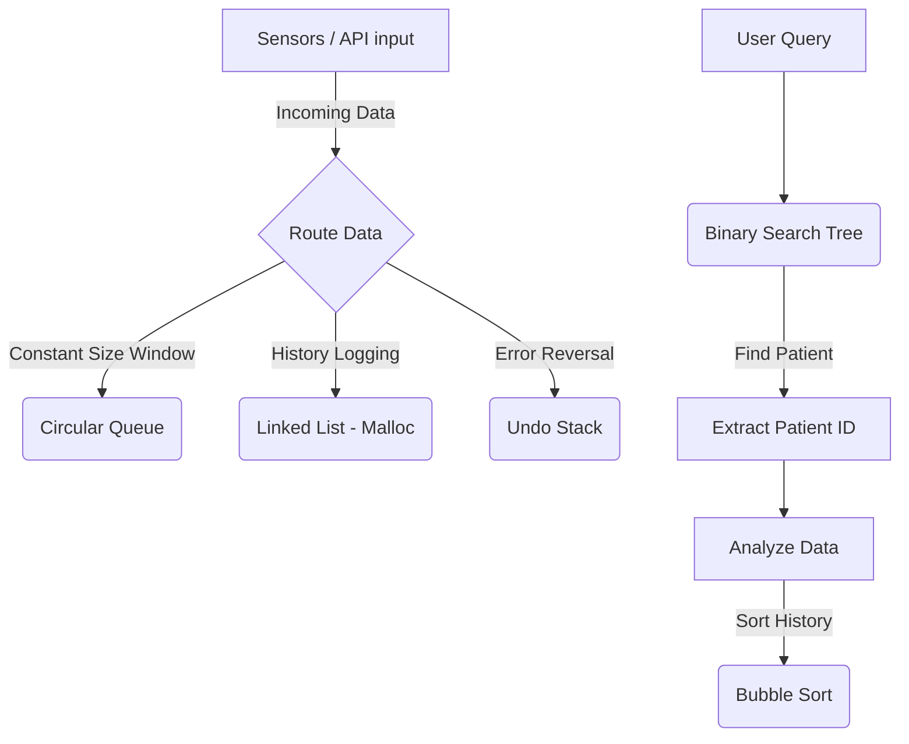

<div align="center">
<strong>Pimpri Chinchwad Education Trust’s</strong><br>
<strong>Pimpri Chinchwad College of Engineering (PCCoE)</strong><br>
(An Autonomous Institute)<br>
Affiliated to Savitribai Phule Pune University (SPPU)<br>
ISO 21001:2018 Certified by TUV SUD<br>
<br><br>
<strong>MINI PROJECT REPORT</strong><br>
<strong>Academic Year: 2025-2026 | Semester: II</strong><br>
<strong>Course: Data Structures and Programming Lab</strong><br>
<br><br>
<h2>Project Title: Real-time Health Sensor Data Buffer and Analytics System</h2>
<br>
<strong>Department of Electronics and Telecommunication (E&TC)</strong><br>
<strong>Year: S.Y. | Div: [Your Division] | Batch: [Your Batch]</strong><br>
<br><br>
<strong>Submitted by:</strong><br>
Sarthak (Roll No: [Roll Number])<br>
Rahul (Roll No: [Roll Number])<br>
[Student 3 Name] (Roll No: [Roll Number])<br>
[Student 4 Name] (Roll No: [Roll Number])<br>
<br><br>
<strong>Under the Guidance of:</strong><br>
Dr. S.P Jagtap / Dr. P.V Sontakke / Mrs. Sonali Y Sawant / Dr. Swati V Patil / Mrs. Vaishali N Patil
</div>

<div style="page-break-after: always;"></div>

## 1. Introduction
### Problem Statement & Relevance
In modern medical monitoring systems and telemetry, vital signs such as Heart Rate (HR) and Blood Oxygen saturation (SpO2) are read continuously from real-time sensors. Managing this constant influx of high-frequency data requires a robust, memory-efficient buffering framework to avoid memory leaks or processor stalls. 

This project implements a fully functional Software-based **Real-time Health Sensor Data Buffer and Analytics** platform. It simulates real-time patient telemetry handling, offering endpoints to add, queue, undo, search, and sort sensor data. By adopting C as the core language, the system prioritizes low-level memory management and pointer logic—foundational requirements in Embedded Systems, E&TC, and Robotics applications.

## 2. Objectives
1. **Real-time Data Buffering:** Implement a Circular Queue to effortlessly maintain the latest window of streaming sensor data without reallocating memory.
2. **Historical Data Tracking:** Utilize a Singly Linked List via dynamic memory allocation (`malloc`/`free`) to log full patient reading histories.
3. **Advanced Lookups:** Deploy a Binary Search Tree (BST) for lightning-fast patient searches by name.
4. **Data Analytics:** Implement Bubble Sort to order historical readings by severity (e.g., finding the lowest SpO2 values).
5. **Robust State Reversal:** Integrate an Array-based Stack to allow complete undo operations on erroneous sensor readings.

## 3. Proposed Solution
### Algorithms and Data Structures Used

Our implementation carefully aligns software data structures with real-world Engineering concepts:

*   **Circular Queue (Sensor Ring Buffer):** Used for managing real-time sensor streams without running out of bounds. Ensures bounds-checking via modulo arithmetic. 
    *   *Time Complexity:* `O(1)` for enqueue and peek.
*   **Singly Linked List (Reading History):** Logs historical time-series data. Each new reading is pushed to the `HEAD` so that the latest recorded data can be retrieved instantly.
    *   *Time Complexity:* `O(1)` for insertions at the head; `O(n)` for traversal.
*   **Binary Search Tree (BST) (Patient Indexing):** Fast querying mapping string data (names) to patient internal indices. Includes Inorder successor algorithms for node deletion.
    *   *Time Complexity:* `O(log n)` average-case search/insert/delete.
*   **Stack (Undo Buffer):** Enables rollback of accidentally ingested noise/error data points. Pushes elements during data ingestion and pops them via the undo functionality.
    *   *Time Complexity:* `O(1)` for Push and Pop.
*   **Bubble Sort (Analytics):** Allows medical staff to sort a patient's historical vitals (e.g., ascending HR) to quickly identify the patient's critical baseline events.
    *   *Time Complexity:* `O(n²)` worst-case.
*   **Static Arrays & Structures (Patient Store):** Pre-allocated structures grouping heterogenous data elements (ID, Name, Age).
    *   *Time Complexity:* `O(1)` for address indexing.

## 4. Implementation Details

### Core Technical Concepts Demonstrated
- **Pointer Arithmetic:** Iterating through custom memory heaps for Tree processing and Linked List linking.
- **Memory Management:** Safe implementation of `malloc()` on sensor insert and `free()` for node removal and linked-list destruction upon patient deletion, completely preventing memory leaks.
- **Bitwise/Modulo Masking:** Utilized modulo operation `rb->tail = (rb->tail + 1) % RING_SIZE;` to natively wrap the Circular Queue.

### Architecture Flowchart


### Code Snippets

**1. Circular Queue Insertion Segment:**
```c
void ring_enqueue(int patient_idx, int hr, int spo2, long long ts) {
    SensorRingBuffer *rb = &ring_buffers[patient_idx];
    rb->hr[rb->tail] = hr;
    rb->spo2[rb->tail] = spo2;
    rb->timestamps[rb->tail] = ts;
    // Circular wrap logic:
    rb->tail = (rb->tail + 1) % RING_SIZE;   
    if (rb->count < RING_SIZE) rb->count++;
    else rb->head = (rb->head + 1) % RING_SIZE;
}
```

**2. Dynamic Linked List Allocation & Linking:**
```c
void reading_insert(int patient_idx, int hr, int spo2, long long ts) {
    ReadingNode *node = (ReadingNode *)malloc(sizeof(ReadingNode));
    if (!node) return;
    node->hr = hr;
    node->spo2 = spo2;
    node->timestamp = ts;
    // O(1) Head insertion via raw pointers
    node->next = reading_heads[patient_idx];  
    reading_heads[patient_idx] = node;        
}
```

### Screenshots Placeholder
*Note: Before submitting the physical report, replace these bracketed areas with actual images from your project.*
*   **(Fig 1)** [Screenshot of the Web Dashboard Home Page showing Live Data stream]
*   **(Fig 2)** [Screenshot of the `server.exe` terminal printing server logs during compilation/start]
*   **(Fig 3)** [Screenshot of the Patient Detail page showing a sorted historical data Graph]

## 5. Conclusion
### Observations
The integration of fundamental data structures drastically optimized the ingestion telemetry compared to linear generic arrays. The Circular Queue natively prevented the requirement of a system "Garbage Collector", efficiently capping memory usage. Concurrently, using a BST minimized search bottlenecks that would normally plague a linear array-based querying system.

### Limitations
Given the scope of the project, Bubble Sort handles array restructuring for analytics in `O(n²)` time. While acceptable for a small historical viewport, larger time-series datasets over months would freeze the single-threaded server. 

### Future Enhancements
In subsequent iterations, algorithms such as Quick Sort (`O(n log n)`) could replace Bubble Sort to improve large-scale throughput. Additionally, the system could employ real hardware bitwise mask filtering over UART/I2C connections rather than solely functioning over a REST HTTP Simulation.

## 6. References
1. SPPU Data Structures Course Material and Textbooks.
2. Kernighan, B. W., & Ritchie, D. M. (1988). *The C Programming Language* (2nd ed.). Prentice Hall.
3. Custom Implementation of Graph-Trees, "Algorithms in C" - Robert Sedgewick.
